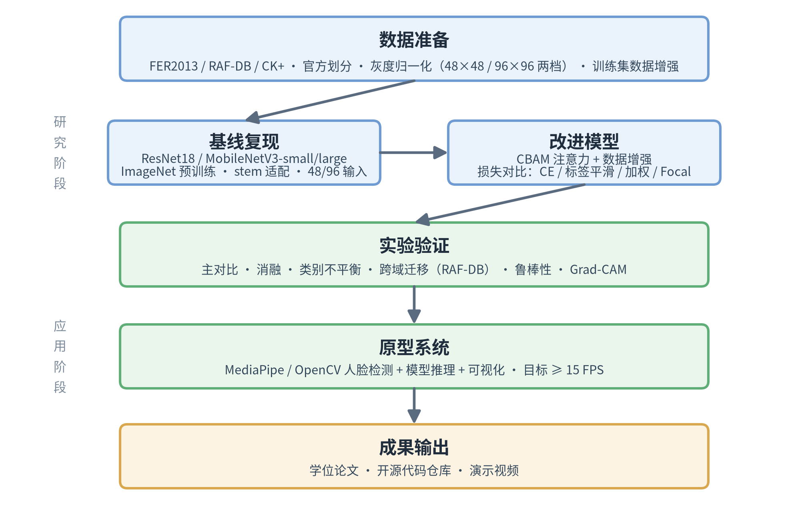

# 本科毕业设计（论文）开题报告

**题目：基于深度学习的人脸表情识别算法研究**

学生姓名：____________　　学号：____________

专业：____________　　学院：____________

指导教师：____________　　开题日期：2026 年 11 月

## 一、选题背景与意义

人脸表情是人类传递情绪、意图和态度的重要非语言信号，也是情感计算与人机交互领域的核心研究对象。随着智能教育、心理健康监测、驾驶员状态预警、智能客服、虚拟数字人等应用的快速发展，自动人脸表情识别（Facial Expression Recognition，FER）在学术界和工业界都受到广泛关注。让机器准确理解人的情绪状态，是实现自然人机交互、构建有温度的智能系统的重要前提，因此开展人脸表情识别算法研究具有明确的应用需求。

早期的人脸表情识别主要依赖手工设计的几何特征与纹理特征，再配合传统分类器完成识别，这类方法可解释性较强，但对光照、姿态、遮挡等变化敏感，难以适应真实场景。深度学习技术的兴起使表情识别从“特征工程”转向“端到端学习”：以卷积神经网络（CNN）为代表的模型在 FER2013、RAF-DB 等公开数据集上不断刷新识别精度，注意力机制、轻量化网络、迁移学习等技术的引入进一步提升了模型的判别能力与实用性。

尽管深度学习方法已取得显著进展，真实场景中的人脸表情识别仍面临多方面挑战：一是数据集标注噪声较大，FER2013 等数据集由众包标注，存在表情歧义与错标问题；二是类别分布不平衡，例如“高兴”类样本占比明显高于其他类别，模型容易偏向多数类；三是跨数据集、跨场景泛化能力不足，分辨率、光照、姿态、年龄与文化背景差异都会造成明显的性能下降；四是高精度模型往往计算量大，难以满足实时部署需求。

因此，本课题以公开数据集为基础，研究注意力机制与数据增强相结合的改进方法，并系统开展跨数据集泛化与鲁棒性验证，最后实现实时人脸表情识别演示系统。研究结果在理论上可以验证注意力机制与迁移学习在表情识别任务中的有效性，在应用上可为智能教育、驾驶员状态监测等场景提供参考，具有较好的研究意义与应用价值。

## 二、国内外研究现状

### 2.1 传统表情识别方法

早期的人脸表情识别研究主要基于手工特征。几何特征通过面部关键点之间的距离、角度和比例刻画表情形变；纹理特征则采用局部二值模式（LBP）、方向梯度直方图（HOG）、Gabor 小波等描述面部纹理变化；两类特征结合后送入支持向量机、随机森林等分类器完成识别。这类方法计算量小、可解释性强，但特征设计依赖人工经验，对光照变化、头部姿态、遮挡以及个体差异较为敏感，跨场景泛化能力有限[12]。

### 2.2 基于深度学习的表情识别方法

随着深度学习的发展，卷积神经网络成为人脸表情识别的主流方法。以 ResNet[5] 为代表的深度残差网络通过残差连接缓解了深层网络的退化问题，成为表情识别最常用的骨干网络之一；MobileNetV3[6] 等轻量化网络则在精度与速度之间取得平衡，为实时部署提供了可能。在此基础上，注意力机制被广泛引入：CBAM[7] 通过通道注意力与空间注意力增强关键区域的特征响应；DAN[8] 采用多头交叉注意力结构，在多个数据集上取得了具有竞争力的性能。与此同时，迁移学习与数据增强技术被用于缓解小样本与过拟合问题[11]。针对 FER2013 等数据集的标注噪声，SCN[14] 通过估计样本不确定性并对训练样本重加权，抑制不确定样本对训练的干扰，为噪声标签下的表情识别提供了有效思路。

2021 年以后，Transformer 结构以及 CNN 与 Transformer 的混合结构成为表情识别研究的新趋势：TransFER[15] 利用关系感知的 Transformer 建模面部局部区域之间的关系；POSTER[16] 采用金字塔跨融合结构融合 CNN 与 Transformer 特征，在多个公开基准上取得了有竞争力的结果，说明 2021 年后该领域的研究重心正逐步从纯 CNN 结构向注意力与 Transformer 混合结构扩展。

数据集的发布也极大推动了该领域发展。文献[1] 构建的 FER2013 数据集包含约 3.6 万张 48×48 灰度图像，是使用最广泛的基准之一；文献[2] 针对 FER2013 标注噪声问题提出了众包重标注版本 FERPlus；文献[3] 发布的 RAF-DB 数据集提供了真实场景下的高分辨率表情图像；文献[4] 的 CK+ 数据集则常用于跨数据集泛化测试。文献[13] 的 AffectNet 进一步推动了自然场景表情识别研究。此外，也有研究尝试用图神经网络建模面部关键点之间的结构关系[9]，为表情识别提供了新的思路。总体来看，近年来 Transformer 类方法[15][16]不断增多，但受计算开销与数据规模限制，CNN 及其变体仍是表情识别的主流基线，这也是本课题选择 ResNet18、MobileNetV3 作为骨干网络的原因。

需要说明的是，现有文献的实验协议（划分方式、人脸对齐、输入尺寸、是否使用额外数据）并不统一，不同方法之间的数字不能直接比较；公开文献报道的 FER2013 private test 准确率约为 75%—76%，RAF-DB 约为 92%—93%，这些数字仅作为领域参考，不作为本课题直接对标的依据。

### 2.3 现存问题分析

综合现有研究可以发现，人脸表情识别仍存在以下不足：第一，标签噪声与类别不平衡问题突出，FER2013 中表情歧义样本与错标样本会对训练产生负面影响，多数类主导也会拉低少数类识别效果，尽管已有不确定性重加权[14]、标签平滑等缓解手段，噪声标注与少数类识别问题仍未完全解决；第二，多数改进工作集中在单一数据集上的精度提升，跨数据集、跨场景的泛化能力研究相对不足；第三，真实场景中的遮挡、低光照、低分辨率等扰动对模型的影响缺乏系统验证，检测框抖动与关键点对齐误差等工程因素也少有考察；第四，高精度模型（尤其是 Transformer 类方法[15][16]）计算开销较大，低分辨率输入与实时场景下的精度—速度权衡仍需进一步研究。

针对上述问题，本课题拟在 ResNet18、MobileNetV3 等成熟骨干网络基础上，引入 CBAM 注意力机制与数据增强策略，并以交叉熵、标签平滑、类别加权与 Focal Loss 等多组损失函数对比替代单一的 Focal Loss 方案，同时分析 Focal Loss 在噪声标签下的局限；跨数据集实验以 FER2013→RAF-DB 为主、CK+ 为补充，系统分析域偏移来源；最后实现实时表情识别演示系统，验证方法的实用性。

## 三、研究内容与目标

### 3.1 研究目标

在 FER2013 公开基准上复现并改进人脸表情识别模型，使改进模型在准确率与 Macro-F1 上稳定优于基线（以多种子均值计），具备以 FER2013→RAF-DB 为主的跨数据集泛化能力与实时推理能力，最终形成一套可复现的算法方案与可演示的原型系统。

### 3.2 研究内容

（1）数据集构建与基线复现。采用 FER2013 官方划分完成数据预处理与增强管线，明确 public test 与 private test 的使用协议；针对 48×48 与 96×96 输入完成 ResNet18、MobileNetV3 等基线的输入—骨干适配，统一评测指标（准确率、Macro-F1、混淆矩阵、参数量、FLOPs 与推理时间），建立规范、可复现的实验基准。

（2）基于注意力机制与数据增强的改进模型。在残差网络主干中嵌入 CBAM 通道—空间注意力模块，结合随机裁剪、水平翻转、旋转、亮度与对比度扰动等数据增强策略；针对类别不平衡与标签噪声问题，对比交叉熵、标签平滑、类别加权与 Focal Loss[10] 等多组损失函数；通过消融实验验证各模块的贡献，并结合 Grad-CAM 分析模型的关注区域。

（3）跨数据集泛化与鲁棒性研究。以 FER2013 训练、RAF-DB 测试开展主跨数据集实验，对比直接迁移与目标域微调的效果，CK+ 作为补充跨库实验；测试模型在噪声、遮挡、低分辨率以及检测框抖动、对齐误差等扰动下的性能变化，分析域偏移的主要来源，并给出改进建议。

（4）实时表情识别原型系统。基于 MediaPipe/OpenCV 实现人脸检测与表情分类的实时演示系统，展示识别结果与置信度，并分析精度与帧率之间的权衡。

## 四、研究方案与技术路线

### 4.1 数据集与预处理

本课题使用 FER2013 作为主数据集，其包含 35,887 张 48×48 灰度图像，共 7 类表情（愤怒、厌恶、恐惧、高兴、悲伤、惊讶、中性）。FER2013 官方划分为训练集 28,709 张、public test 3,589 张与 private test 3,589 张：训练仅使用训练集，public test 仅用于模型选择与早停，private test 只在最终评估时使用一次，避免因反复调参造成测试集信息泄露。作为更严格协议的补充，也可在训练集内再划分 10% 作为验证集，用于与 public test 的选模结果做一致性对照。

跨数据集实验以 RAF-DB 为主：RAF-DB 为 7 类真实场景表情数据集，与本课题关注的跨场景泛化问题一致，实验采用其官方 train/test 划分，先在 FER2013 上训练并在 RAF-DB 测试集上直接评测（零样本迁移），再在 RAF-DB 训练集上微调后评测（目标域微调）。CK+ 降为补充实验：CK+ 共 327 条带表情标签的序列，常用评估集约为 981 帧，其原始标签为 7 类（含 contempt）且不含中性，跨库评估时按 6 类映射处理（忽略 contempt，不评估中性类），类别映射关系见表 1。FERPlus（8 类众包软标签，含 contempt，另有 unknown 标记）仅作为可选分析，使用时须说明将其映射回 7 类（忽略 contempt 与 unknown）的方式。

表 1　FER2013/RAF-DB 与 CK+ 的类别映射

| 类别（FER2013 / RAF-DB，7 类） | CK+ 原始标签 | 映射与说明 |
| 愤怒 | anger | 对应 |
| 厌恶 | disgust | 对应 |
| 恐惧 | fear | 对应 |
| 高兴 | happiness | 对应 |
| 悲伤 | sadness | 对应 |
| 惊讶 | surprise | 对应 |
| 中性 | 无 | CK+ 不含中性类，跨库评估时按 6 类计算 |
| — | contempt | 忽略，不参与跨库评估 |

预处理流程为：FER2013 图像已完成人脸对齐与 48×48 裁剪，可直接使用；RAF-DB 按官方提供的 bbox 裁剪人脸区域；CK+ 取每条序列的峰值帧（apex frame），按人脸检测框/关键点对齐后裁剪。三套数据统一转换为灰度图，并分别缩放到 48×48 与 96×96 两档，按 ImageNet 均值与方差归一化；为适配 ImageNet 预训练权重，灰度图复制为 3 通道（或等价地对 RGB 权重求和，二者在实现中固定其一并在论文中说明）。

数据增强仅在训练集上进行：随机裁剪（padding=4）、水平翻转、±10° 随机旋转、亮度与对比度扰动；public test、private test、RAF-DB 测试集与 CK+ 评估集只做确定性的缩放与归一化。实验全程固定随机种子，严格使用官方划分，避免数据泄漏；若使用 FERPlus 等派生标签，需说明其与 FER2013 的样本对应关系与重叠处理方式。

### 4.2 模型设计与改进

基线模型选用 ResNet18 与 MobileNetV3（small、large 两档），均采用 ImageNet 预训练参数初始化进行迁移学习。由于本课题输入为 48×48（或 96×96）灰度图，与 ImageNet 的 224×224 彩色输入差异明显，必须显式进行输入与骨干的适配：ResNet18 将首层 conv1 改为 3×3、stride=1 并去掉 maxpool，使 48×48 输入在末端 stage 的特征图空间尺寸为 6×6，可正常接全局平均池化；MobileNetV3-small/large 相应调整首层 stride（或采用 96×96 输入），以保持末端特征图尺寸与预训练结构兼容。灰度图复制为 3 通道，或对 conv1 的 RGB 权重求和后使用（实现中固定其一并在论文中说明）。此外设置 48×48 与 96×96 两组输入尺寸的小消融，评估分辨率对精度与速度的影响。

改进方案在主干的每个 stage 残差块内部、卷积之后、残差相加之前插入 CBAM[7] 通道—空间注意力模块（插入位置在全文实验中固定；若改为残差相加之后插入，需在消融中单独说明），增强对眼睛、嘴角等关键区域的响应。CBAM 会引入额外的参数量与计算量，实验中将报告各变体的参数量、FLOPs 与单张推理时延，量化注意力模块带来的精度—开销权衡。

针对类别不平衡与标签噪声问题，设计四组损失函数消融：①交叉熵（CE）；②CE + 标签平滑（Label Smoothing）；③类别加权 CE 或重采样（按类别频率加权、过采样少数类）；④Focal Loss[10]（γ=2）。需要指出，Focal Loss 主要针对难例与类别不平衡设计，对标注噪声较为敏感，可能放大被错标样本的梯度贡献，因此将其与标签平滑、类别加权方案一并比较，并讨论 SCN[14] 通过样本不确定性重加权抑制噪声样本的思路作为后续改进方向。所有损失方案均同时报告准确率与 Macro-F1，说明两类指标之间的 trade-off。

训练采用 AdamW 或 SGD 优化器，配合余弦退火学习率与 warmup、早停策略，可选 EMA（指数滑动平均）与 TTA（测试时增强）以进一步稳定结果；数据增强策略按基础增强与增强组合做对比实验，确定最优方案。主对比实验每组使用 5 个随机种子，消融实验使用 3 个随机种子，报告均值±标准差；预训练权重采用 torchvision 官方权重并记录具体版本，通过离线缓存权重、固定依赖版本与随机种子的方式保证实验可复现。

### 4.3 实验方案

实验分为六类：

①主对比实验：比较 ResNet18、MobileNetV3-small、MobileNetV3-large 及各自 +CBAM 变体在 FER2013 private test 上的表现，可选加入 SE、ECA 等注意力机制作为对照；指标为准确率、Macro-F1、参数量、FLOPs 与单张推理时延，主对比实验使用 5 个随机种子并报告均值±标准差。

②消融实验：在最优骨干上依次去掉 CBAM、去掉数据增强、更换损失函数（CE / 标签平滑 / 类别加权 / Focal Loss）、更换输入尺寸（48/96），分析各因素的贡献；消融实验使用 3 个随机种子。

③跨数据集实验：以 FER2013→RAF-DB 为主，对比直接迁移（零样本）与目标域微调后的准确率与 Macro-F1；CK+ 作为补充，按表 1 的 6 类映射报告结果。

④鲁棒性实验：在 FER2013 与 RAF-DB 测试集上施加高斯噪声、随机擦除（遮挡）、降分辨率等扰动，并新增检测框抖动与关键点对齐误差模拟，绘制性能下降曲线。

⑤错误分析：统计混淆矩阵中的 Top-k 混淆对，结合 Grad-CAM 可视化分析模型关注区域，抽取 20—30 张典型错误样本，按表情歧义、遮挡、低质量、疑似标注错误等原因归类分析。

⑥效率分析：统计参数量、FLOPs、单张推理时延与实时帧率；时延在固定硬件上以 batch=1、预热后取中位数的方式测量，并注明 CPU/GPU 型号与输入尺寸。详细实验清单见附录 A。

### 4.4 原型系统实现

系统采用“人脸检测—表情分类—结果可视化”的流程：优先使用 MediaPipe 完成人脸检测与关键点定位，裁剪并对齐人脸区域后送入训练好的模型进行推理，输出表情类别与置信度，并在界面上展示表情标签、置信度与一段时间内的表情统计；若 MediaPipe 在目标 Python 版本上安装受限，则以 OpenCV DNN 或 Haar 级联检测器作为备选方案。界面基于 OpenCV 或 Streamlit 实现，目标帧率不低于 15 FPS；测量时固定输入分辨率与硬件，预热 30 帧后统计 300 帧的平均帧率与端到端时延，并分别报告人脸检测、预处理与模型推理的耗时占比。必要时采用 MobileNetV3 或模型量化以保证实时性。

### 4.5 技术路线

## 五、创新点

（1）在统一的数据划分、输入尺寸与评测协议下，系统复现 ResNet18、MobileNetV3 等基线模型，并通过消融实验定量分析 CBAM 注意力、数据增强与损失函数（含 Focal Loss、标签平滑、类别加权）的贡献，结合 Grad-CAM 对模型关注区域进行可解释性分析，为表情识别中局部特征建模提供可复现的实验依据。

（2）构建“FER2013→RAF-DB 跨数据集测试 + 扰动与对齐鲁棒性测试”的系统性评测方案，分析分辨率、光照、姿态、检测框抖动与对齐误差等域偏移来源，并验证目标域微调策略的有效性。

（3）面向实际应用，实现实时人脸表情识别原型系统，给出精度与速度的权衡分析，验证改进模型的实用性。

## 六、可行性分析

（1）数据可行：FER2013 可通过 Kaggle 竞赛页面获取；RAF-DB 需向作者提交邮件申请；CK+ 需向原作者申请，获取周期较长，作为补充实验；同时准备 KDEF 等公开数据集作为备用。数据申请已列入 11 月计划，若出现延迟，先用 FER2013 完成同库实验，不影响主进度。

（2）技术可行：ResNet、MobileNetV3、CBAM 等模型结构成熟，torchvision、timm 等开源实现丰富；48×48 输入与 ImageNet 预训练骨干的适配方案已明确（stem 改造与灰度通道复制）；实验环境计划采用 Python 3.12—3.15 与 PyTorch 2.x，并锁定依赖版本，规避过新 CPython 版本导致的第三方库 wheel 兼容问题。

（3）算力可行：FER2013 图像尺寸小、数据量适中，单卡即可完成训练；本地暂无独立 GPU，计划使用 Colab、Kaggle 等免费 GPU 平台或按需租用云端 GPU 完成全部实验，并预留算力排队时间。

（4）基础可行：本人已修完深度学习、计算机视觉等相关课程，掌握 Python、PyTorch 的基本使用，具备完成本课题的编程与实验基础。

（5）时间可行：课题任务可分解为数据、基线、改进、实验、系统、论文六个阶段，按进度安排可在毕业设计周期内完成，并预留了缓冲时间。

（6）风险可控：以复现公开基线为保底，改进工作为增量；即使改进效果不及预期，仍可完成完整的对比实验、跨数据集分析与原型系统，保证毕业设计工作量。

## 七、进度安排

| 时间 | 主要任务 | 阶段目标 |
| 2026 年 11 月（剩余） | 修订开题报告；搭建实验环境（Python 3.12—3.15、PyTorch）；申请 RAF-DB/CK+ 数据；实现 FER2013 预处理与增强管线 | 完成开题答辩，数据与管线就绪 |
| 2026 年 12 月 | 完成 ResNet18、MobileNetV3 基线的输入—骨干适配与复现（含 48/96 输入对比）；建立统一评测脚本与结果记录规范 | 基线结果可复现 |
| 2027 年 1 月 | 实现 CBAM 注意力改进与四组损失函数消融；完成主对比与首轮消融实验 | 改进模型跑通，主对比完成 |
| 2027 年 2 月 | FER2013→RAF-DB 跨数据集实验；鲁棒性实验与 Grad-CAM 错误分析；撰写论文方法章 | 核心实验完成约 80% |
| 2027 年 3 月 | 开发实时表情识别原型系统；完成论文第三、四章；参加中期检查 | 系统可演示；中期通过 |
| 2027 年 4 月 | 完成论文初稿；查重与修改；补充实验与图表 | 论文定稿 |
| 2027 年 5 月 | 整理代码与实验记录；制作答辩 PPT 与演示视频；参加答辩 | 完成答辩 |

注：各阶段具体时间以学校教学安排与中期检查通知为准；进度安排中已预留约两周缓冲时间，并已将寒假（2027 年 1—2 月）以及数据申请、算力排队的不确定性考虑在内。

## 八、预期成果

（1）完成一篇符合本科毕业设计要求的学位论文，包含基线对比、改进模型、消融实验、跨数据集与鲁棒性分析、错误分析与系统实现等内容。

（2）量化指标方面：以 FER2013 private test 为最终评测集，ResNet18、MobileNetV3 等基线的准确率预期约为 71%—73%；改进模型以 5 个随机种子的均值计，目标在基线基础上准确率提升 1.0—1.5 个百分点、Macro-F1 提升 2—3 个百分点，并给出均值±标准差与显著性检验结果。本课题不宣称达到公开文献的 SOTA 水平，重点在于统一协议下的可复现增量与系统性分析。

（3）实现一套实时人脸表情识别原型系统，支持摄像头实时检测与表情分类展示，目标帧率不低于 15 FPS。

（4）整理开源代码仓库与实验记录，包含数据预处理、训练、评测与系统代码，保证实验可复现。

（5）视研究进展，整理形成小论文或软件著作权申请材料。

## 参考文献

[1] GOODFELLOW I J, ERHAN D, CARRIER P L, et al. Challenges in representation learning: a report on three machine learning contests[C]//Proceedings of the ICML 2013 Workshop on Challenges in Representation Learning. 2013. arXiv:1307.0414.

[2] BARSOUM E, ZHANG C, FERRER C C, et al. Training deep networks for facial expression recognition with crowd-sourced label distribution[C]//Proceedings of the 18th ACM International Conference on Multimodal Interaction. 2016: 279-283.

[3] LI S, DENG W. Reliable crowdsourcing and deep locality-preserving learning for expression recognition in the wild[C]//Proceedings of the IEEE Conference on Computer Vision and Pattern Recognition. 2017: 2852-2861.

[4] LUCEY P, COHN J F, KANADE T, et al. The extended Cohn-Kanade dataset (CK+): a complete dataset for action unit and emotion-specified expression[C]//Proceedings of the IEEE Computer Society Conference on Computer Vision and Pattern Recognition Workshops. 2010: 94-101.

[5] HE K, ZHANG X, REN S, et al. Deep residual learning for image recognition[C]//Proceedings of the IEEE Conference on Computer Vision and Pattern Recognition. 2016: 770-778.

[6] HOWARD A, SANDLER M, CHU G, et al. Searching for MobileNetV3[C]//Proceedings of the IEEE/CVF International Conference on Computer Vision. 2019: 1314-1324.

[7] WOO S, PARK J, LEE J Y, et al. CBAM: convolutional block attention module[C]//Proceedings of the European Conference on Computer Vision. 2018: 3-19.

[8] WEN Z, LIN W, WANG T, et al. Distract your attention: multi-head cross attention network for facial expression recognition[EB/OL]. arXiv:2104.00932, 2021.

[9] VELIČKOVIĆ P, CUCURULL G, CASANOVA A, et al. Graph attention networks[C]//Proceedings of the International Conference on Learning Representations. 2018.

[10] LIN T Y, GOYAL P, GIRSHICK R, et al. Focal loss for dense object detection[C]//Proceedings of the IEEE International Conference on Computer Vision. 2017: 2980-2988.

[11] SHORTEN C, KHOSHGOFTAAR T M. A survey on image data augmentation for deep learning[J]. Journal of Big Data, 2019, 6: 60.

[12] LI S, DENG W. Deep facial expression recognition: a survey[J]. IEEE Transactions on Affective Computing, 2022, 13(3): 1195-1215.

[13] MOLLAHOSSEINI A, HASANI B, MAHOOR M H. AffectNet: a database for facial expression, valence, and arousal computing in the wild[J]. IEEE Transactions on Affective Computing, 2019, 10(1): 18-31.

[14] WANG K, PENG X, YANG J, et al. Suppressing uncertainties for large-scale facial expression recognition[C]//Proceedings of the IEEE/CVF Conference on Computer Vision and Pattern Recognition. 2020: 6897-6906.

[15] XUE F, WANG Q, GUO G. TransFER: learning relation-aware facial expression representations with transformers[C]//Proceedings of the IEEE/CVF International Conference on Computer Vision. 2021: 3601-3610.

[16] ZHENG C, MENDIETA M, CHEN H. POSTER: a pyramid cross-fusion transformer network for facial expression recognition[C]//Proceedings of the IEEE/CVF International Conference on Computer Vision Workshops. 2023.

注：建议在知网补充检索“人脸表情识别”“表情识别 综述”等关键词，引用近三年中文核心期刊文献 2—3 篇，并按学校规定的著录格式补入，引用前请核对原文信息。

## 附录 A 实验设计清单

| 实验类型 | 具体设置 | 评价指标 | 对应章节 |
| 主对比实验 | ResNet18、MobileNetV3-small/large 及各自 +CBAM 变体，可选 SE/ECA 对照，在 FER2013 private test 上对比（5 seeds，均值±标准差） | 准确率、Macro-F1、参数量、FLOPs、推理时延 | 第 4 章 |
| 消融实验 | 依次去掉 CBAM、去掉数据增强、更换损失函数（CE / 标签平滑 / 类别加权 / Focal Loss）、更换输入尺寸（48/96）（3 seeds） | 准确率、Macro-F1、参数量变化 | 第 4 章 |
| 类别不平衡分析 | 统计类别分布，报告各类别精确率、召回率与 F1，绘制混淆矩阵与混淆对 Top-k | per-class F1、混淆矩阵 | 第 4 章 |
| 跨数据集实验 | FER2013→RAF-DB 直接迁移与目标域微调（主）；FER2013→CK+ 按 6 类映射（补充） | 准确率、Macro-F1 变化 | 第 4 章 |
| 鲁棒性实验 | 测试集施加高斯噪声、随机擦除、降分辨率，并模拟检测框抖动与关键点对齐误差 | 性能下降曲线 | 第 4 章 |
| 错误分析 | 混淆对 Top-k 统计 + Grad-CAM 可视化 + 20—30 张典型错误样本归类 | 定性分析与可解释性 | 第 4 章 |
| 系统性能测试 | 摄像头实时识别，固定硬件；batch=1、预热 30 帧后统计 300 帧 | FPS、端到端时延 | 第 5 章 |

## 附录 B 风险与应对措施

| 风险 | 可能表现 | 应对措施 |
| 数据标注噪声 | 测试准确率上限受限、个别类别混淆严重 | 使用 FERPlus 软标签或标签平滑；在论文中说明数据噪声是公开基准的固有特性 |
| 类别不平衡 | 少数类召回率低、模型偏向高兴类 | 采用类别加权、重采样或 Focal Loss 对比，报告 per-class F1 |
| 输入/骨干适配不当 | 48×48 输入下特征图过小，基线精度异常偏低 | 明确 stem 改造方案；做 48/96 输入对比与前向形状、精度 sanity check |
| public/private test 误用 | 用 private test 调参导致结果虚高、不可复现 | public test 仅用于选模与早停；private test 只评估一次并留档 |
| 跨数据集性能下降 | FER2013 训练后在 RAF-DB 上精度明显降低 | 做直接迁移与目标域微调对比；结合数据增强与归一化缩小域差异 |
| RAF-DB/CK+ 申请延迟 | 跨库实验无法按期开展 | 11 月即提交申请；先用 FER2013 完成同库实验；准备 KDEF 等备用数据 |
| 类别映射不一致 | 跨库指标虚高或不可解释 | 明确 CK+ 忽略 contempt、不含中性的 6 类映射；FERPlus 忽略 contempt 与 unknown |
| 显存不足 | 批量大小受限、大模型无法训练 | 使用 48×48 小图与轻量模型；开启混合精度；减小批量并使用梯度累积 |
| 无 GPU 或算力排队 | 训练缓慢、实验周期延长 | 使用 Colab/Kaggle 免费 GPU 或租卡；优先跑主对比；控制消融规模 |
| Python 版本依赖过新 | 关键库缺少 wheel、环境搭建失败 | 采用 Python 3.12—3.13 等成熟版本；锁定依赖版本；必要时使用容器复现 |
| 实时性不足 | 摄像头演示帧率低 | 采用 MobileNetV3、输入分辨率调整或模型量化 |
| 进度延误 | 实验未按时完成、中期检查仓促 | 以复现基线为保底，改进工作分优先级；每周记录进度，预留两周缓冲 |

指导教师意见：

签字：____________　　日期：____年__月__日
